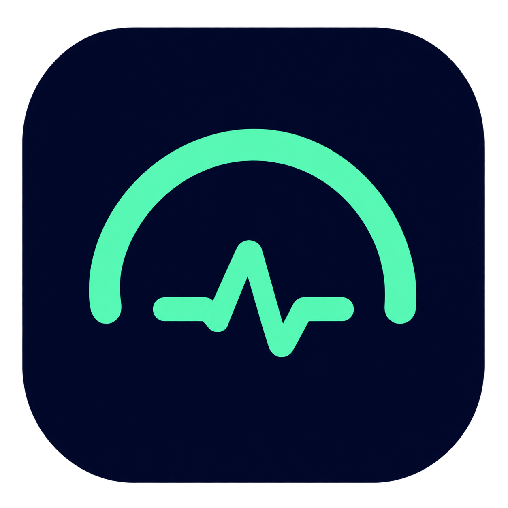
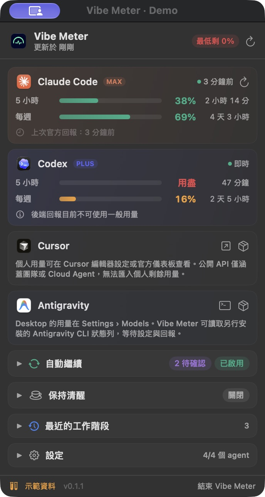

<div align="center">
  <p align="center"><a href="README.md">繁體中文</a>　|　<a href="README.en.md">English</a></p>

  <p align="center"></p>

  # Vibe Meter

  **A macOS menu bar companion for vibe coders**

  Keep an eye on your AI coding agents' usage,  
  prepare a handoff when needed, and pick up where you left off.

  `macOS 14+`　·　`Apple Silicon`　·　`v0.1.1`

  **[Download v0.1.1](https://github.com/LeoFeng0816/vibe-meter/releases/tag/v0.1.1)**　·　[Core features](#core-features)　·　[Installation](#installation)　·　[Agent support](#agent-support)

  

  <sub>A screenshot of the running demo window with fictional data. The regular app opens from the macOS menu bar.</sub>
</div>

---

## Core features

- **Usage at a glance:** Open the menu bar icon to see available usage, windows, and reset times for enabled agents.
- **Choose your agents:** Enable the agents you use. Disabled agents are hidden, their usage is not read, and they do not participate in resume plans.
- **Alerts and handoffs:** Get notifications as usage approaches its limit, or copy a handoff prompt to help Codex pick up the work.
- **Continue with confidence:** Resume plans live in an expandable section. When required evidence is unavailable, the app marks the plan as needing confirmation and lets you choose whether to continue manually.
- **Fits smaller screens:** Expanded content scrolls with a mouse or trackpad when it exceeds the available height.

## Continue after usage resets

The menu shows work interrupted by a usage limit, resume progress and items that need your attention. Codex can continue once capacity returns and the required checks pass.

## What’s new in v0.1.1

- Choose the agent and five-hour or weekly allowance in the menu bar. Stale, missing or disabled selections show an unavailable state.
- The app reads new official Claude Code status line data as it arrives; opening the panel or refreshing rereads it. The bridge uses each session's monotonically increasing official response counter to ignore replays and out-of-order old values, and a file lock serializes writes from several sessions. After 15 minutes without new data, the app shows when it last received data. Values change only after Claude Code itself receives a response; Vibe Meter never sends Haiku, `claude -p`, or other subscription queries.
- Codex limits are checked every 30 seconds with the official read-only `account/rateLimits/read` (can be turned off). Opening the panel checks right away, sharing one query with the timer and the refresh button. Checks pause while offline, asleep, or when Codex is off; on failure the last official value stays visible, marked with the failure and its time, and the interval grows up to 5 minutes.
- Automatic Codex continuation is the default. Manual scope can limit it to a specific Codex session, signed-in account and model. Both modes require official quota checks.
- Choose Traditional Chinese, Simplified Chinese or English. Manage notification permission, set a remaining-usage threshold, and keep the Mac awake for a duration or during observed Codex work.
- Check official GitHub releases anonymously, optionally download a verified DMG, or opt in to installing signed updates automatically. Upgrade from v0.1.0 manually first. Future automatic updates require a signed appcast and ZIP available to anonymous visitors. A private repository is unavailable to anonymous checks.

## Installation

1. Download and open `Vibe-Meter-0.1.1.dmg` from the **[v0.1.1 Release](https://github.com/LeoFeng0816/vibe-meter/releases/tag/v0.1.1)**.
2. Drag **Vibe Meter** to **Applications**.
3. Open Vibe Meter from Applications, then click its gauge icon in the menu bar at the top of the screen. It does not appear in the Dock.

**Requirements:** macOS 14 or later on Apple Silicon. This release is ad-hoc signed and has not been notarized by Apple.

### If macOS blocks the app

If macOS says the developer cannot be verified or Apple cannot check the app for malicious software, first make sure you obtained the installer from the Vibe Meter GitHub Release linked above. Then:

1. After dragging the app into **Applications**, try to open **Vibe Meter** from Applications. If macOS blocks it, click **Done** or close the alert.
2. Choose ** → System Settings → Privacy & Security**.
3. Scroll down to **Security**, find the message about Vibe Meter being blocked, and click **Open Anyway**.
4. Authorize the action with an administrator password or Touch ID if prompted. When the warning appears again, confirm the app is Vibe Meter and click **Open**.
5. Once it opens, click the gauge icon in the menu bar. No Dock icon appears.

If **Open Anyway** is absent, try opening the app from Applications again and return to the same settings page. A work or school Mac may restrict this action; contact its administrator. If macOS warns that the app **is damaged, contains malware, or will damage your computer**, do not open it; verify its source and integrity first. See [Apple's instructions](https://support.apple.com/en-us/102445).

## Agent support

Vibe Meter displays data only when a reliable source is available; it does not invent usage numbers.

| Agent | Usage and features | Notes |
|:--|:--|:--|
| **Claude Code** | Read official status line reports | The app asks before connecting, upgrading or disconnecting and makes a backup. Refresh rereads the local bridge. |
| **Codex** | Read-only live queries through `codex app-server`, with labeled local records as fallback | Requires Codex CLI. The CLI bundled with ChatGPT or Codex App is supported. |
| **Cursor** | Editor settings or official dashboard, plus a handoff prompt | The public team and Cloud Agent APIs do not provide personal remaining allowance. |
| **Antigravity** | Optional official CLI status line bridge. In Desktop, open Settings › Models. | Local Desktop testing did not expose a readable quota interface. The CLI is installed and configured separately. |

### About auto-continue

Automatic mode checks for an official quota failure on the same Codex session, the original model and account usage observed around the interruption. After reset, it rechecks the current account, model quota, explicit permission and latest turn before dispatch. Account observations do not prove the historical account, and a switch during a monitoring gap may go unobserved. Missing data, no recorded quota denial or a detected account change leaves the plan pending confirmation. The app waits for a new official turn after a request is queued.

**Accounts with only the general Codex limit: one attempt at reset + 30 seconds (on by default; can be turned off under Auto-continue).** With codex-cli 0.167, `account/rateLimits/read` reports only the general `codex` bucket with a null `normalModelSlug`, and the official turn error says only `usageLimitExceeded`. Official data therefore can't prove that the original model's limit has reset. At your explicit request, Vibe Meter sends one fixed, neutral continuation prompt ("continue the unfinished task…", with no claim that the limit has reset) to the original session at the official reset time + 30 seconds, when all of these hold:

- The latest official turn in that session is `usageLimitExceeded`, with an official completion time and the original model, and it isn't a subagent.
- The same account was confirmed before the stop, and within a bounded time around the stop that account's general `codex` bucket was observed full with an official reset time (the latest of any full windows). Observations with a null permission aren't used.
- After the due time, a fresh official response shows the same account with a non-null ordinary-usage permission (`false` still gets the authorized attempt), and no workspace spend cap, depleted credits, or spend control. If Codex reports a later valid reset, the attempt moves to that time + 30 seconds, up to 7 days.
- Right before sending, the latest turn and model are reread; nothing is sent if you already continued, the account or scope changed, or the plan was cancelled or turned off.

Each session gets one attempt: a file lock reserves it across app processes, and a damaged record blocks sending. Later stops, even in a new cycle, are attempted automatically only after you choose Continue Manually in that session, because official turns can't tell your new work from the automatic prompt. This is a time-based attempt: the session may stop again, or enabled credits may be used. A successful queue only means the message was queued; it counts as continued once Codex starts a new turn. Codex doesn't currently offer a built-in "continue after the limit resets".

Two current Vibe Meter instances share continuation settings. Turning off auto-continue, disabling Codex, turning off the timed attempt, changing scope, or cancelling a plan stops any affected request that the other instance has yet to submit. Vibe Meter cannot withdraw a request once the CLI has started.

Since Claude Code 2.1.234, "Continue automatically at usage limit" is built in: interactive sessions signed in with a claude.ai subscription wait in the original window and continue the task after the reset (up to 3 times in a row). Vibe Meter relies on that for Claude Code. It shows the capability, the value in your user settings file, what the official transcript shows about the stop and what followed, and how to check `/config` or `/rate-limit-options` in the original CLI. Vibe Meter sends no prompts, opens no new windows, never cancels or takes over the built-in wait, and doesn't change Claude settings. Claude Code controls when the original window resumes. Vibe Meter updates the display as it reads local records. Managed settings, `--settings`, or project settings can override the user setting, and the app can't confirm the effective value or whether a window is waiting. `-p`, the SDK, background sessions, API keys, and usage-based billing have no built-in wait. Resets more than 24 hours away, Remote Control, and teammates need you to choose a wait in the original terminal. If the Mac slept more than about 30 minutes and the limit reset meanwhile, press Enter in the original window. [Official docs](https://code.claude.com/docs/en/interactive-mode#wait-for-a-usage-limit-to-reset)

### Usage alerts

Set a remaining percentage threshold. Enabled agents can notify when fresh five-hour or weekly data falls below it. Each window is deduplicated separately. Check notification status in Permissions.

### Connect the Antigravity CLI

Use the terminal icon on the Antigravity card to copy the official `statusLine` configuration. Review and merge it into `~/.gemini/antigravity-cli/settings.json`. Preserve any existing custom status line before editing. For Desktop usage, open Settings › Models. [Official Antigravity CLI docs](https://antigravity.google/docs/cli/statusline)

## Permissions and data

- **Claude Code settings:** Connecting, upgrading a legacy bridge, or disconnecting requires confirmation; the app backs up `~/.claude/settings.json` before changes.
- **Local records:** Depending on enabled agents, the app reads Codex session and usage records in `~/.codex` and Claude Code transcripts in `~/.claude/projects`. Live Codex usage is queried through the official CLI.
- Manual resume queues a Codex request. Claude Code continues in its original window through its built-in feature; Vibe Meter sends nothing. App data is stored in `~/Library/Application Support/Vibe Meter`.
- **Brand icons:** Used only to identify agents; see [brand assets](docs/BRAND-ASSETS.md) for sources and limitations.

## Build from source

```bash
swift build && swift test    # build and test
./scripts/build-app.sh       # build/v0.1.1/Vibe Meter.app
./scripts/build-dmg.sh       # build and verify the v0.1.1 DMG
./scripts/render-preview.sh  # render a labeled UI preview
```

The DMG layout uses hash-locked `dmgbuild`. Packaging requires Xcode to build the updater from pinned Sparkle 2.10.0 source. Cursor and Antigravity brand assets are downloaded from official sources and SHA-256 verified by the build script. See [requirements and data sources](docs/PLAN.md) and the [handoff notes](HANDOFF.md).

<details>
<summary>Dry-run and demo modes</summary>

Inspect current usage and sessions without sending messages:

```bash
open -n --env VIBEMETER_DRY_RUN=1 "/Applications/Vibe Meter.app"
```

Open the demo window with fictional data:

```bash
open -n --env VIBEMETER_DEMO=1 "/Applications/Vibe Meter.app"
```

See also the [light, dark, and expanded UI previews](docs/vibe-meter-preview.png). A Windows version is planned separately.

</details>

## Donation

If you enjoy Vibe Meter, you can support the project. Thank you!

[](https://www.paypal.com/ncp/payment/UY8JAHZCRVDLY)

**Cryptocurrency**

- Stablecoins (USDT, USDC, PYUSD; Solana network)：`BCyMirZrcGhcKUonkhykfnUq5pQbeUbXgCQmwJQfjy1o`
- Solana (Solana network)：`BnE2VfdgKE2aubg9YpJuPSTFpFgbMawaqcbxXJkff2kL`
- Ethereum (Ethereum network)：`0xa8d689b94a54414362b2bd0e6f0cb2a74651f4b0`
- Bitcoin (BTC Taproot)：`bc1panr25wetvhl2kyxquu3re6ts4pw6g7fwdul8hpv4shaqu7g9qhyq68twql`
