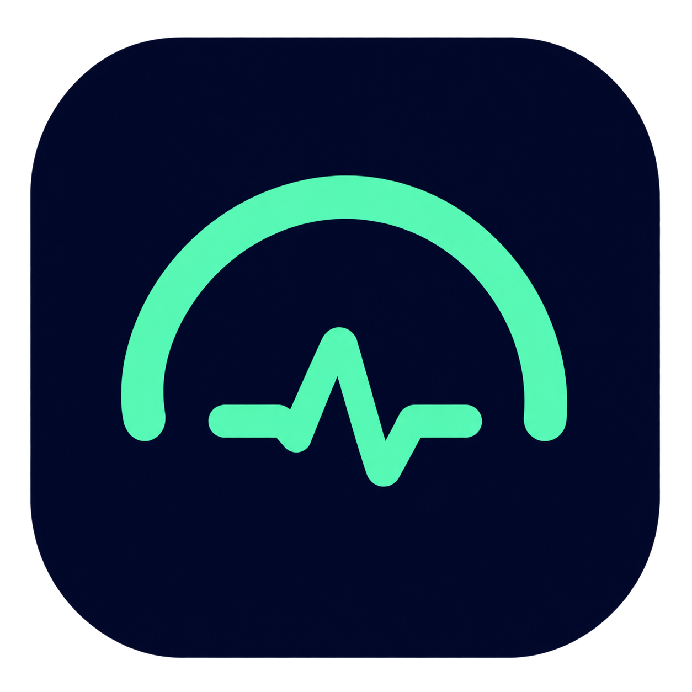
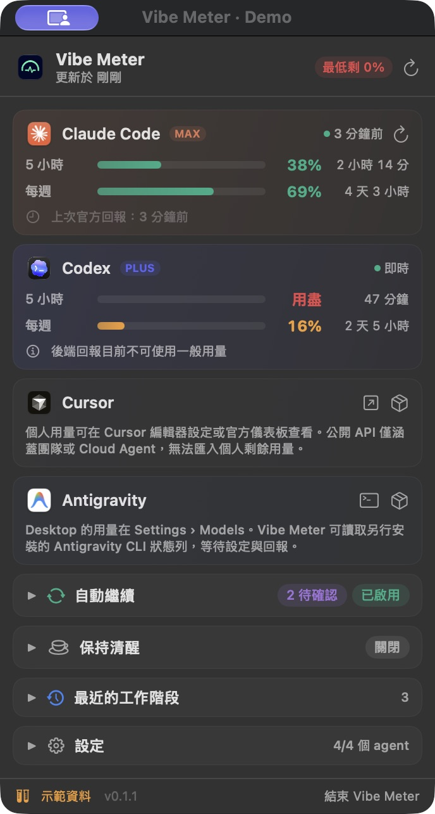

<div align="center">
  <p align="center"><a href="README.md">繁體中文</a>　|　<a href="README.en.md">English</a></p>

  <p align="center"></p>

  # Vibe Meter

  **給 vibe coder 的 macOS 選單列用量助手**

  從螢幕上方掌握 AI coding agents 的用量，  
  在需要時準備交接，讓工作更容易接續。

  `macOS 14+`　·　`Apple Silicon`　·　`v0.1.1`

  **[下載 v0.1.1](https://github.com/LeoFeng0816/vibe-meter/releases/tag/v0.1.1)**　·　[核心功能](#核心功能)　·　[安裝方式](#安裝)　·　[Agent 支援](#agent-支援)

  

  <sub>實際執行中的示範視窗，使用虛構資料。正式版由 macOS 上方選單列開啟。</sub>
</div>

---

## 核心功能

- **快速查看**：點選單列圖示，查看已啟用 agent 可取得的用量、週期與重設時間。
- **保留需要的 agent**：在設定中選擇顯示項目；停用後不顯示、不讀取其用量，也不參與續作。
- **用量提醒與交接**：接近額度上限時收到通知，或複製交接指令，整理工作以交給 Codex 接手。
- **更安心地繼續**：續作計畫收在展開區塊。無法確認所需資訊時會顯示「待確認」，由使用者決定是否手動繼續。
- **小螢幕也好操作**：展開內容超出可用高度時，可用滑鼠或觸控板捲動。

## 額度恢復後，繼續工作

在面板中查看因額度中止的工作、續作進度與待確認項目。Codex 會在額度恢復並通過驗證後繼續工作。

## v0.1.1 新功能

- 在設定中選擇選單列要顯示的 agent 與 5 小時／每週週期。資料過期、週期缺失或 agent 停用時顯示不可用。
- Claude Code 的官方狀態列帶來新資料時立即讀取，打開面板或手動刷新會重讀。bridge 以每個工作階段單調遞增的官方回應計數排除重播與亂序的舊值，並以檔案鎖序列化多個工作階段的寫入。15 分鐘沒有新資料時顯示「用量未更新」與上次時間。數值只在 Claude Code 自己收到回應後更新，Vibe Meter 不發送 Haiku、`claude -p` 或其他訂閱查詢。
- Codex 每 30 秒以官方唯讀 `account/rateLimits/read` 查詢額度（可關閉）。打開面板會立即查詢，與計時器、刷新按鈕共用同一個查詢；離線、睡眠或停用時暫停，失敗時保留上次官方值並標示失敗與時間，間隔逐步拉長到 5 分鐘。
- Codex 預設採自動續作。若要限定範圍，可切到「手動限定」，從最近工作階段選擇一個 Codex 工作階段、登入帳戶及模型。兩種模式皆需通過官方額度檢查。
- 支援繁體中文、簡體中文與英文。可調整通知權限、剩餘用量通知門檻及定時或 Codex 工作中保持清醒。
- 匿名檢查 GitHub 的正式 release。可選擇驗證並下載 DMG，或開啟預設關閉的簽章自動安裝。v0.1.0 須先手動安裝 v0.1.1。後續自動更新需要公開可匿名取得的簽章 appcast 與 ZIP。私人儲存庫會顯示匿名無法讀取。

## 安裝

1. 前往 **[v0.1.1 Release](https://github.com/LeoFeng0816/vibe-meter/releases/tag/v0.1.1)**，下載並開啟 `Vibe-Meter-0.1.1.dmg`。
2. 將 **Vibe Meter** 拖曳至 **Applications（應用程式）**。
3. 在「應用程式」中開啟 Vibe Meter，再點選螢幕上方選單列的量規圖示。App 不會出現在 Dock。

**系統需求：** macOS 14 以上、Apple Silicon。本版採 ad-hoc 簽章，尚未經 Apple 公證。

### 如果 macOS 阻擋開啟

如果出現「無法驗證開發者」或「Apple 無法檢查是否包含惡意軟體」等提示，請先確認安裝檔來自上方的 Vibe Meter GitHub Release，再按照以下步驟操作：

1. 將 App 拖入 **應用程式**後，先從「應用程式」嘗試開啟 **Vibe Meter**；出現阻擋提示時按「完成」或關閉提示。
2. 點選螢幕左上角 ** → 系統設定 → 隱私權與安全性**。
3. 向下捲動至「安全性」，找到關於 Vibe Meter 被阻擋的提示，點選 **仍要打開**（Open Anyway）。
4. 依 macOS 提示使用管理員密碼或 Touch ID 授權。警告再次出現時，確認是 Vibe Meter 後點選 **打開**。
5. 開啟成功後，到螢幕上方選單列點量規圖示；不會有 Dock 圖示。

若沒有「仍要打開」，請重新從「應用程式」嘗試開啟一次，再回到同一設定頁。公司或學校管理的 Mac 可能限制此操作，請洽管理員。若警告指出 App **已損壞、包含惡意軟體或會損害電腦**，請勿繼續開啟，先重新確認檔案來源與完整性。詳見 [Apple 官方說明](https://support.apple.com/zh-tw/102445)。

## Agent 支援

Vibe Meter 只顯示可取得且可辨識來源的數據；無可靠資料時不會自行推算用量。

| Agent | 用量與功能 | 需要注意 |
|:--|:--|:--|
| **Claude Code** | 讀取官方狀態列回報 | 連接、升級與中斷前會詢問並備份。重新整理會重讀本機 bridge。 |
| **Codex** | 唯讀 `codex app-server` 即時查詢，必要時顯示標記為本機紀錄的備援 | 需要 Codex CLI，可使用 ChatGPT／Codex App 內附版本。 |
| **Cursor** | 編輯器設定或官方儀表板；提供封裝指令 | 公開 API 的團隊與 Cloud Agent 用量不等於個人剩餘額度。 |
| **Antigravity** | 可選擇連接官方 CLI 狀態列；Desktop 請到 Settings › Models | Desktop 本機測試未能驗證可讀的額度介面。CLI 必須另行安裝及設定。 |

### 關於自動繼續

Codex 自動模式不逐一詢問。App 會比對原工作階段的官方額度失敗、原模型與同一時段的帳戶用量觀察。重設後仍須驗證目前帳戶、模型週期及官方許可，送出前再確認最新 turn 仍是中止錨點。觀察無法證實歷史帳戶，監測間斷也可能看不到中途帳戶切換。未收錄官方拒絕、欄位缺失或觀察到帳戶更換時，計畫會標示「待確認」。Codex CLI 排入佇列後，App 會等到官方確認有新 turn 才顯示後續活動。

**只有一般 Codex 額度的帳戶：重設＋30 秒嘗試一次（預設開啟，可在「自動繼續」關閉）。** 實測 codex-cli 0.167 的 `account/rateLimits/read` 只回報一般 `codex` 額度桶，`normalModelSlug` 為 null；官方 turn 錯誤只回報 `usageLimitExceeded`，沒有指出是哪個額度擋下。因此官方資料無法證明原模型的額度已恢復。依使用者明確要求，Vibe Meter 在下列條件全部成立時，於官方重設時間＋30 秒對原工作階段送出一次固定的中性續作提示（「請從中斷處繼續未完成的任務…」，不宣稱額度已恢復）：

- 官方最新 turn 是同一工作階段的 `usageLimitExceeded`，有官方完成時間、原模型，不是子代理。
- 中止前已確認同一帳戶，中止前後有界時間內觀察到該帳戶的一般 `codex` 桶已滿，以及官方重設時間（多個週期取最晚者）。許可為 null 時不採用。
- 到期後的新鮮官方回應仍是同一帳戶，且一般用量許可不是 null（`false` 也會依授權嘗試）；沒有工作區花費上限、credits 用盡或 spend control。若官方給出較晚的有效重設，改在新時間＋30 秒，最多延 7 天。
- 送出前重讀最新 turn 與模型；使用者已自行繼續、換帳戶、範圍不符、取消或停用時不送。

每個工作階段只嘗試一次：跨 App 程序以檔案鎖保留，記錄損壞時拒絕。之後的中止即使在新週期，也要等你在該工作階段按過「手動繼續」才會再自動嘗試，因為官方 turn 無法分辨是你的新工作還是自動提示。這是依時間的嘗試，可能再次中止，也可能使用已啟用的 credits；排入成功只代表已排入，要等 Codex 開始新的 turn 才算繼續。Codex 目前沒有內建「額度重設後自動繼續」。

同時開啟兩個新版 Vibe Meter 時，兩者共用續作設定。關閉自動續作、停用 Codex、關閉定時嘗試、變更範圍或取消計畫，會阻止其他實例尚未提交的相關續作。CLI 已啟動的請求無法從 Vibe Meter 撤回。

Claude Code 2.1.234 起內建「Continue automatically at usage limit」：使用 claude.ai 訂閱的互動式工作階段會在原視窗等待重設並自行接續（最多連續 3 次）。Vibe Meter 以此為 Claude Code 的續作方式，只顯示能力、使用者設定檔中的值、官方 transcript 可觀察的中止與後續狀態，以及在原 CLI 用 `/config`、`/rate-limit-options` 的引導。Vibe Meter 不送出提示、不開新視窗、不取消或接管原生等待，也不修改 Claude 設定。Claude Code 依原視窗自己的排程續作。Vibe Meter 讀取本機紀錄時更新顯示。managed settings、`--settings` 或專案設定可能覆蓋使用者設定，App 無法確認生效值或原視窗是否正在等待。`-p`、SDK、背景工作階段、API key 與按量計費沒有原生等待；重設超過 24 小時、Remote Control 與 teammate 需在原終端自行選擇；電腦睡眠超過約 30 分鐘且期間已重設時需在原視窗按 Enter。[官方說明](https://code.claude.com/docs/en/interactive-mode#wait-for-a-usage-limit-to-reset)

### 用量提醒

在設定調整「剩餘百分比」門檻。啟用的 agent 有新鮮、低於門檻的 5 小時或每週額度時會通知；各週期分別去重。可在「權限」確認通知狀態。

### Antigravity CLI 連接

在 Antigravity 卡片點終端機圖示複製官方 `statusLine` 設定片段，檢查並合併到 `~/.gemini/antigravity-cli/settings.json`。若已使用自訂 statusLine，先保留原設定。已安裝的 Desktop 可在 Settings › Models 看用量。 [Antigravity CLI 官方文件](https://antigravity.google/docs/cli/statusline)

## 權限與資料

- **Claude Code 設定**：連接、升級舊 bridge 或中斷連接時，App 會先詢問並備份 `~/.claude/settings.json`。
- **本機紀錄**：App 會依啟用的 agent 讀取 `~/.codex` 的工作階段與用量紀錄，以及 `~/.claude/projects` 的 Claude Code transcript；Codex 即時用量透過官方 CLI 查詢。
- 手動繼續 Codex 會排入佇列。Claude Code 由官方原生功能在原視窗續作，Vibe Meter 不送出任何內容。App 資料保存在 `~/Library/Application Support/Vibe Meter`。
- **品牌圖示**：僅用於識別 agent；來源與限制見 [品牌素材說明](docs/BRAND-ASSETS.md)。

## 從原始碼建置

```bash
swift build && swift test    # 建置與測試
./scripts/build-app.sh       # 建立 build/v0.1.1/Vibe Meter.app
./scripts/build-dmg.sh       # 建立並驗證 v0.1.1 DMG
./scripts/render-preview.sh  # 產生標示為預覽的介面圖
```

DMG 版面使用以雜湊鎖定的 `dmgbuild`。正式打包需要 Xcode，會從鎖定的 Sparkle 2.10.0 原始碼建置更新器。Cursor／Antigravity 品牌素材由建置腳本從官方來源下載並驗證 SHA-256。更多細節請見 [需求與資料來源](docs/PLAN.md)及[交接文件](HANDOFF.md)。

<details>
<summary>測試與示範模式</summary>

唯讀檢視目前用量與工作階段：

```bash
open -n --env VIBEMETER_DRY_RUN=1 "/Applications/Vibe Meter.app"
```

以虛構資料開啟示範視窗：

```bash
open -n --env VIBEMETER_DEMO=1 "/Applications/Vibe Meter.app"
```

示範畫面另有[淺色、深色與展開版面預覽](docs/vibe-meter-preview.png)。Windows 版將於未來另行開發。

</details>

## 捐款 Donation

如果你喜歡 Vibe Meter，歡迎支持這個專案。感謝你的支持！

[](https://www.paypal.com/ncp/payment/UY8JAHZCRVDLY)

**加密貨幣**

- 穩定幣（USDT、USDC、PYUSD；Solana 網路）：`BCyMirZrcGhcKUonkhykfnUq5pQbeUbXgCQmwJQfjy1o`
- Solana（Solana 網路）：`BnE2VfdgKE2aubg9YpJuPSTFpFgbMawaqcbxXJkff2kL`
- Ethereum（Ethereum 網路）：`0xa8d689b94a54414362b2bd0e6f0cb2a74651f4b0`
- Bitcoin（BTC Taproot）：`bc1panr25wetvhl2kyxquu3re6ts4pw6g7fwdul8hpv4shaqu7g9qhyq68twql`
